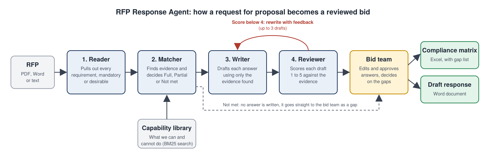

# RFP Response Agent

A multi-agent system that turns a Request for Proposal (RFP) into a compliance matrix and a reviewed first-draft response.

Presales teams spend days on every RFP: reading it line by line, checking each requirement against what the company can actually deliver, and writing answers that do not overpromise. This project automates the first pass and leaves the judgement calls to people.



## What it does

1. **Reader** extracts every requirement from the RFP (PDF, Word or text), splits combined sentences, and tags each one Mandatory or Desirable.
2. **Matcher** searches a capability library (what the company can and cannot do) and decides Full, Partial or Not met, citing the evidence.
3. **Writer** drafts an answer for each requirement using only that evidence.
4. **Reviewer** independently scores each draft from 1 to 5. Drafts below 4 go back to the Writer with feedback, up to 3 drafts.
5. **Bid team (human)** edits and approves answers in the web app. Export is locked until every answer is approved.

Outputs:
- **Compliance matrix (Excel)** with evidence, scores and a "Needs Human Decision" sheet
- **Draft response (Word)** grouped by RFP section, with gaps flagged for the bid team

## Design choices

- **Grounded answers only.** The Writer and Reviewer only see the evidence the Matcher found. Made-up evidence ids are dropped in code.
- **Gaps never get an answer.** A requirement marked Not met skips the Writer and goes straight to a person. The system does not write promises the company cannot keep.
- **Independent review loop.** The Reviewer never sees the Writer's instructions, only the draft, so it is a real check rather than self-grading.
- **Measured, not guessed.** `evaluate.py` scores the agents against hand-labelled answers. The key safety metric is **overclaims**: real gaps the system marked as Full.
- **Simple retrieval on purpose.** The capability library is small, so BM25 keyword search is enough. For a large library, swap `knowledge.py` for vector search (for example Azure AI Search) without touching the agents.
- **Runs offline.** Demo mode replaces the model with simple rules, so you can run everything without a key. It also gives a keyword baseline to compare the real agents against.

## Project structure

```
rfp-response-agent/
  app.py                    Web app (Streamlit): run, review, approve, download
  run.py                    Command line: run on one RFP file
  evaluate.py               Score the agents against the labelled answers
  rfp_agent/
    config.py               Settings (read from .env)
    llm.py                  One helper to call the model and get JSON back
    demo_llm.py             Rule-based stand-in for the model (demo mode)
    documents.py            Reads PDF, Word and text files
    knowledge.py            Capability library and BM25 search
    graph.py                LangGraph wiring of the four agents and the review loop
    outputs.py              Excel compliance matrix and Word draft response
    agents/
      reader.py  matcher.py  writer.py  reviewer.py
  data/
    capability_library.json What our fictional company (Brightpath Digital) can and cannot do
    rfps/                   Two sample RFPs (PDF) and their source text
    golden/                 Hand-labelled correct answers for evaluation
  scripts/build_sample_rfps.py   Rebuilds the sample PDFs from the text files
  tests/test_pipeline.py    End-to-end tests (no key needed)
```

## Quick start

Requires Python 3.11 or newer.

```bash
python3 -m venv .venv
source .venv/bin/activate            # Windows: .venv\Scripts\activate
pip install -r requirements.txt
cp .env.example .env                 # then edit .env

pytest                               # check everything works
python run.py data/rfps/harbourview_logistics_rfp.pdf
streamlit run app.py
python evaluate.py
```

## Using a real model

Set these in `.env`:

```
LLM_PROVIDER=azure
AZURE_OPENAI_ENDPOINT=https://your-resource.openai.azure.com
AZURE_OPENAI_API_KEY=your-key
AZURE_OPENAI_DEPLOYMENT=your-deployment-name
```

Or use `LLM_PROVIDER=openai` with `OPENAI_API_KEY`.

## Sample data

All data is synthetic. Brightpath Digital, Harbourview Logistics and Aldermoor University are fictional. The two sample RFPs contain 48 labelled requirements, including deliberate traps: numbers that fall short (99.95% SLA required, 99.9% offered), capacity above what was tested, features only available as paid add-ons, combined requirements in one sentence, and tender-process instructions that are not requirements.

## Tech stack

Python, LangGraph, Azure OpenAI / OpenAI, rank-bm25, Streamlit, pypdf, python-docx, openpyxl, pytest.
